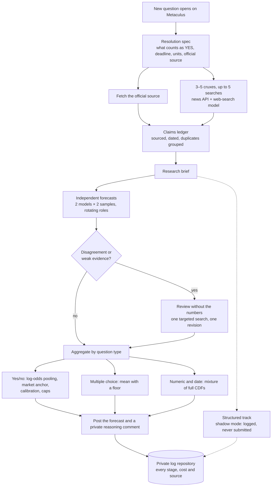

# SwampBot

An autonomous AI forecasting bot. SwampBot reads a question about a real-world event and researches it. It then has several frontier language models forecast the question independently, combines their answers with statistical methods, and submits a probability or a full probability distribution to [Metaculus](https://www.metaculus.com/). It runs unattended every 20 minutes on GitHub Actions.

[](pyproject.toml)
[](LICENSE)
[](https://www.metaculus.com/tournament/fall-futureeval-2026/)

- **Competing in:** the Metaculus [Fall 2026 FutureEval](https://www.metaculus.com/tournament/fall-futureeval-2026/) tournament, which is for bots only and has a $50k prize pool. It runs from Sept 28, 2026 to Jan 6, 2027.
- **Question types:** yes/no, multiple choice, numeric and date.
- **Cost:** about $1.15 of model API calls per question, measured from the account balance.
- **Stack:** Python 3.11, asyncio, LiteLLM over OpenRouter, AskNews, the Metaculus forecasting-tools SDK, pytest (100+ tests) and GitHub Actions.

## What makes it different

A simple forecasting bot searches the topic, asks a model for a number and averages the answers. SwampBot changes each of those steps.

1. **It reads the resolution rules first.** Before searching, it turns the question's resolution criteria into a structured spec: what exactly counts as YES, the deadline, thresholds, units and the official source. It then fetches that source directly.
2. **It searches the cruxes, not the topic.** It lists the 3–5 unknowns that would most change the forecast and spends its search budget on those. The budget is at most five queries, split between a news API and a web-search model according to the type of question.
3. **It counts each piece of evidence once.** A claims ledger records each fact with its source, dates and the cruxes it bears on. Reports of the same event share an independence group, so ten articles quoting one press release count as one piece of evidence.
4. **The models forecast independently, from different angles.** Two models from different providers (up to three can be configured) each forecast twice. Each forecast starts from a different reasoning role: base rates, causal mechanisms, or overlooked scenarios. Which model gets which role rotates from question to question.
5. **A review happens only when it's worth the cost.** A review is triggered when:
   - the models disagree materially,
   - the research came back thin, or
   - a model flags weak evidence.

   The reviewer audits the reasoning without seeing anyone's numbers and names one targeted search. Each model may then revise once and is told it need not agree with the reviewer.
6. **Each question type is aggregated its own way.**
   - **Yes/no:** forecasts are pooled in log-odds space, shrinking toward a prior when the models disagree. A matching prediction market is blended in at low weight, but only after a language model confirms it asks the same question with compatible resolution rules. The result is capped at 2–98%, a range taken from the log-score break-even between being slightly too cautious and being badly wrong.
   - **Multiple choice:** forecasts are averaged, with a floor that only lifts options close to zero.
   - **Numeric and date:** each model gives 11 quantiles, from 1% to 99%. The code turns each set into a full cumulative distribution with proper tails (on a log scale where the question uses one). It mixes these distributions and checks the result against Metaculus's submission rules before sending it.
7. **A pre-registered experiment runs alongside.** On suitable yes/no questions a structured track runs in shadow mode: the model supplies base rates and odds factors, and the code does the Bayesian arithmetic. Its result is logged but never submitted. The hypotheses, sample sizes and decision rule were registered in advance in [docs/prereg_structured_track.md](docs/prereg_structured_track.md).

## How a question flows through the bot



Every stage is logged. So a change to aggregation, calibration or caps can be tested on past questions without calling a model again.

## Built to run unattended

- **Time limits and budgets:**
  - per-call timeouts;
  - a per-question deadline that ends at least two minutes before the question closes;
  - a time budget for each run;
  - at most two questions at once, with a cap on simultaneous model calls.
- **Research that degrades gracefully:** retries, a fallback provider, a circuit breaker after repeated failures and a one-hour cache. If the full pipeline fails, the bot falls back to a simpler two-search path.
- **Strict outputs:** every model answer is checked against a JSON schema. Probabilities must sum to 1, quantiles must be in order and values must stay in bounds. A bad answer gets one retry that may fix the format but not the judgement.
- **Failure isolation:** a question that fails twice is skipped until it is retried on purpose. A credit or authentication error stops the run without marking any question as failed.
- **Spend guard:** each run checks the API key's remaining credit before starting any question.
- **Prompt-injection hygiene:** question text and retrieved web pages are passed to the models as data, never as instructions.
- **Observability:** each question writes a JSON event to the log. The event holds every model's forecast, cost, latency and errors, plus the value after each aggregation stage: median, after review, after shrinkage, after the market anchor, after calibration, and final. Research text is stored under a content hash. After each run, the logs are pushed to a separate private repository. A reasoning comment that failed to post is re-posted on the next run.

## Learning from resolved questions

- **Replay harness:** every model forecast and every stage is logged. So alternative aggregation, calibration and capping pipelines can be re-scored on resolved questions without new model calls. Pipelines are compared on a time-ordered split, using paired bootstrap confidence intervals over the same questions.
- **Gated calibration:** Platt scaling is fitted on the bot's own resolved forecasts and penalised toward leaving forecasts unchanged. It only switches on after 100 yes/no questions have resolved, so a handful of early results can't distort it.
- **Forecast review:** the *Review recent forecasts* workflow scores resolved questions with the community [bot-review](https://github.com/LouisP96/metaculus-bot-review) package. It also helps find where the reasoning went wrong.

## Repository layout

| Path | What it does |
| --- | --- |
| `run_adaptive.py` | Command-line entry point: picks the tournament, checks credit, then forecasts as a dry run or publishes |
| `adaptive_bot.py` | The strategy: research, the ensemble, aggregation and the run guards |
| `forecast_logic.py` | Prompts, output validation, review triggers and the review-and-revise engine |
| `research_v2.py` | Resolution spec, source fetching, cruxes, claims ledger and the research brief |
| `market_anchor.py` | Finds a prediction market that asks the same question |
| `structured_track.py` | Prompts and parsing for the shadow structured track |
| `forecast_upgrades/` | Aggregation, calibration, numeric distributions, the structured-track maths, replay and evaluation |
| `forecast_logging.py` | Event log, per-call cost telemetry and the content-addressed research store |
| `upgrade_config.py` | Feature flags and tuning constants |
| `scripts/` | Resolution sync, replay and calibration fitting, coverage check |
| `tests/` | The pytest suite |
| `.github/workflows/` | Scheduled forecasting, the weekly replay, and manual review and test runs |
| `main.py`, `main_with_no_framework.py` | Metaculus's original template bot, kept for reference |

[docs/CODEBASE_MAP.md](docs/CODEBASE_MAP.md) maps each stage of the pipeline to its functions. [docs/CHANGELOG.md](docs/CHANGELOG.md) records each bot version.

## Running it yourself

You need Python 3.11 or newer and [Poetry](https://python-poetry.org/docs/#installation).

```bash
git clone https://github.com/felixworth/SwampBot.git
cd SwampBot
poetry install
cat .env.template .env.adaptive.example > .env
```

In `.env`, replace each `REPLACE_ME` with your `METACULUS_TOKEN` and `OPENROUTER_API_KEY`. Add `ASKNEWS_API_KEY` for news search. The other lines set the models, research routes and time budgets.

```bash
# Dry run on Metaculus's practice tournament: forecasts one question and posts nothing
poetry run python run_adaptive.py --mode test_questions --limit 1

# Forecast the live tournament and post the results
poetry run python run_adaptive.py --mode tournament --tournament-id fall-futureeval-2026 --publish

# Run the test suite
poetry run pytest
```

### Deploying on GitHub Actions

`.github/workflows/run_bot_on_tournament.yaml` runs the bot on a schedule. It reads these repository secrets and variables:

| Kind | Name | Holds |
| --- | --- | --- |
| Secret | `METAC_API` | Metaculus bot token |
| Secret | `METAC_OPENR_API` | OpenRouter API key |
| Secret | `ASKNEWS_API_KEY` | AskNews key (optional) |
| Secret | `DATA_REPO_TOKEN` | Token that can push to the private log repository |
| Variable | `BOT_MODELS` | One to three comma-separated model IDs |
| Variable | `BOT_RESEARCHER`, `BOT_RESEARCH_FALLBACK` | Research routes |
| Variable | `BOT_TOURNAMENT_ID` | Tournament slug, such as `fall-futureeval-2026` |
| Variable | `DATA_REPO` | `owner/name` of the private log repository |

GitHub's own scheduler is unreliable at a 20-minute interval. So an external scheduler also starts the workflow through GitHub's `workflow_dispatch` API.

## Roadmap

- Point the resolution sync at the Metaculus posts API, so that resolved outcomes reach the replay harness and calibration automatically.
- At 150 resolved questions, run the pre-registered test of the structured track. It joins the submitted forecast only if it beats the current pipeline.

## Credits and licence

SwampBot is built on Metaculus's [bot template](https://github.com/Metaculus/metac-bot-template) and its [forecasting-tools](https://github.com/Metaculus/forecasting-tools) SDK. It is released under the [MIT licence](LICENSE).

Built by [felixworth](https://github.com/felixworth).
